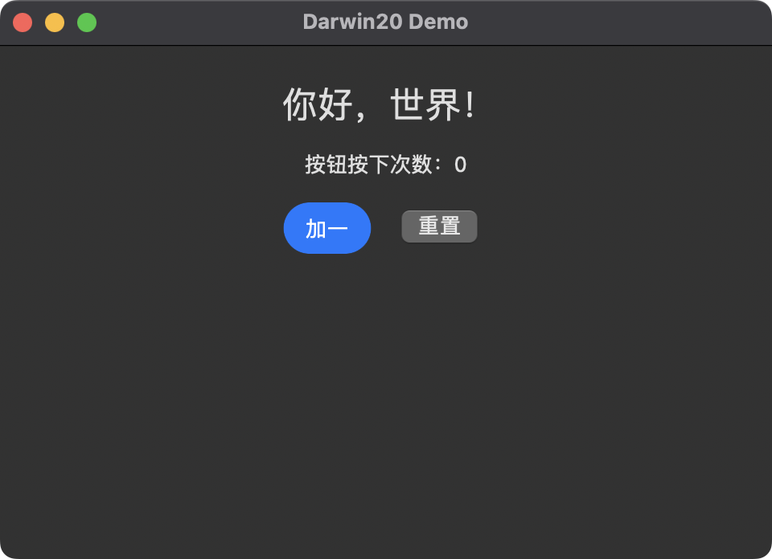
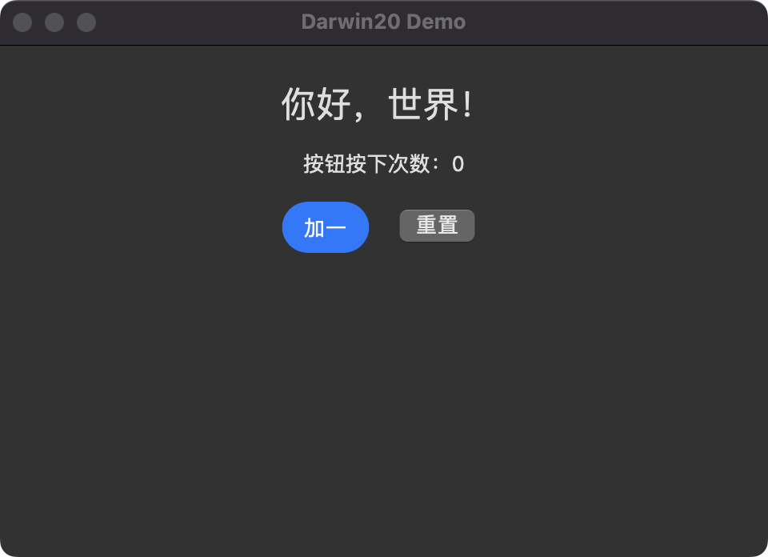

# Darwin 20 Apple 后端

> 本文记录上一轮共享原生后端实验，不代表已完成上游 SwiftUI 的等效移植。当前执行顺序、实际工具链审查及验收条件以 [macOS 分阶段兼容计划](macOS-Compatibility.md) 为准。iOS 工作暂停。

本分支从 AimesSoft/Bern 的 `ffbdbdf3d41bb6492a8b13d3fa6182ee636606ee` 创建。
目标是为同一份 Bern 声明提供 macOS 11 / iOS 14 基线的 SwiftUI 和纯 Objective-C 入口。

## 内部实现与复用边界

Bern 的源界面是 Rust `#[component]` 与 `ui!` 声明。`bern-compiler` 解析声明、检查翻译与功能契约，生成 `bern-ir::Application`。各后端只消费 IR，不改业务引擎。

新的 `bern-backend-objc` 将经过平台样式解析的 IR 编译为应用内嵌的数据，以及 Objective-C 原生界面运行时。类型、表达式、会话、命令、查询与窗口实例继续使用现有协议定义和 C ABI。命令行与 MCP 入口继续调用原来的 Rust 引擎和会话通道。

用户已选择共享原生组件方案。`swiftui` 入口使用 Swift 5.3 语法；macOS 使用 `App` 和 `NSViewRepresentable`，iOS 使用 `UIApplicationDelegate`、公开的 `UIHostingController` 子类和 `UIViewRepresentable`，以正确转发旋转、状态栏与主屏幕指示条行为。`appkit` / `uikit` 入口使用 Objective-C 应用生命周期。两者编译**字节相同的 Objective-C 渲染源码与 IR 数据**，由同一套原生控件、测量和事件分派产生界面。这是共享渲染实现，不是两套独立视图树的逐像素近似。

原有生成器仍可通过 `ui = "swiftui-modern"` 显式选择，保留其 macOS 14 / iOS 17 的最低运行版本和新工具链要求。它不参与 Darwin 20 两入口的视觉一致性约定。tvOS 沿用上游实现。

`examples/darwin20-demo` 是由修改后的 `bern new` 创建的独立应用工作区，用同一份计数界面演示两种入口；`examples/showcase` 也增加了对应目标。

## 构建入口

```toml
[targets.macos]
platform = "macos"                 # 默认 swiftui，共享原生渲染

[targets.macos_objc]
platform = "macos"
ui = "appkit"                     # 纯 Objective-C

[targets.ios]
platform = "ios"                   # 默认 swiftui，模拟器

[targets.ios_objc]
platform = "ios"
ui = "uikit"                      # 纯 Objective-C，模拟器

[targets.ios_device]
platform = "ios"
ui = "uikit"                      # 也可使用 swiftui
destination = "device"             # arm64、iphoneos SDK、最低 iOS 14
```

`bern build --target NAME` 构建对应入口。`destination` 只接受 iOS 的 `simulator` / `device`；默认是模拟器。真机构建产生本地签名应用包，不调用 Apple 账号、自动配置或安装设备。普通 iOS 安装还需要应用所属的签名与描述文件；越狱环境的信任方式另行决定。

构建宿主的 Rust 要求继续使用上游声明的 Rust 1.99。降低目标 OS 不代表降低 Rust 构建工具链要求。Swift 入口仅需 Swift 5.3 时代的语法和 SwiftUI 托管 API；纯 Objective-C 入口不链接 SwiftUI。

所有静态依赖（包括 Rust 标准库）也必须支持对应最低系统。链接器将警告视为错误，防止较新系统的预编译依赖悄悄抬高最低版本。普通 PNG 图标生成 iOS 支持的按尺寸/倍率命名的图标文件，通过 `CFBundleIconFiles` 注册，设备构建不依赖模拟器运行时；用户指定 `.appiconset` 时继续使用系统资产编译器。

Objective-C 路径以 macOS 11 / iOS 14 为经过编译检查的基线。没有另设 SwiftUI 版本门槛，但本次没有承诺更早 OS；若进一步降低版本，需要处理 UniformTypeIdentifiers 等基线 API，并重新验证依赖。

## 兼容替代

| 现代后端依赖 | Darwin 20 路径 |
| --- | --- |
| Observation / `@Observable` / `@Bindable` | Rust 状态回调、Objective-C 会话存储和主线程界面更新 |
| Swift concurrency、`Task`、`async/await` | GCD、Foundation/AVFoundation 回调 |
| SwiftUI `Layout` | 原生视图测量与布局，实现行、列、网格、流、叠层、比例轨道 |
| SwiftUI `Canvas` | CoreGraphics 原生绘图 |
| 新版导航、侧栏、菜单和弹层 | AppKit/UIKit 容器与系统控件 |
| 新版窗口 Scene 操作 | `NSWindow` 与 UIKit 视图控制器生命周期，并复用 Bern 窗口协议 |
| 新 `onChange` 重载、Swift 6 语法 | 状态通道驱动原生更新，托管层仅用 Swift 5.3 语法 |

## 自定义复用视图与控件

优先使用系统 UI。普通按钮、文本框、安全输入、多行编辑、开关、滑块、分段选择、菜单、弹出选择、进度、文件选择、窗口和确认对话框使用 AppKit/UIKit 提供的控件。轻量子类只补充 Bern 的测量、样式、事件提交与任意子内容承载，保留系统的键盘、命中与无障碍动作。

标签容器使用 `NSTabView` / `UITabBarController`；iOS 导航使用 `UINavigationController`，并将系统返回操作同步到原来的会话路径。搜索面板使用 `NSPopover` / UIKit popover，配合系统搜索输入与滚动视图。图片使用 `NSImageView` / `UIImageView`；AppKit 的 cover 容器只计算裁切位置。

- `BNRootView`：连接托管窗口与 Bern 窗口实例，报告尺寸与窗口事实。
- `BNLayout`：`NSView` / `UIView` 子类，共享布局测量、内边距、填充、比例与对齐规则。Bern 的 Flow、Rail、Accordion、ScaleBox 和 Positioned 需要统一的组合测量、缩放坐标与命中规则；这些容器由两入口共同使用。
- `BNControl`：原生控件的目标动作适配器；用户操作与外部控制走同一条事件路径，不是另一个业务模型。
- `BNCanvasView` / 形状视图：用 CoreGraphics 实现声明中的绘图，不需要 SwiftUI 新绘图 API。
- `BNMediaSurface` / `BNMediaControlsView` / `BNMediaSlider`：复用 AVFoundation 视频呈现和命令驱动的媒体控制，拖动预览与提交分开。
- `BNDropView`：处理 AppKit/UIKit 文件拖入，外部 `set_file` 与原生拖放共享文件类型检查和命令路径。
- `BNSvgView`：仅 SVG 内容使用隔离的 WebKit 文档，保留上游的动画协议与导航限制；不向文档提供应用命令通道。
- `BNGestureView` / `BNMarqueeView`：原生缩放与拖动调值、无障碍调值、可暂停的滚动文字；手势预览期间推迟重建，结束时提交命令。
- 原生标签、文本输入、按钮、开关、滑块、菜单等继续使用 AppKit/UIKit 控件；自定义容器仅承担 Bern 声明要求的组合布局与语义。

可用功能以目标的能力检查为准。未实现的组件或样式应在生成前明确报错，不能把空白视图、无效点击或静态替代当成等同实现。共享实现保证两个入口不会出现不同的组件支持集；它本身不能证明已覆盖上游全部功能。

## 验证边界

生成器契约检查对照两入口的原生源码、模型、能力和部署目标；原生编译开启旧系统 API 可用性错误。文本格式化测试直接执行 Foundation 实现，并与 Rust 协议格式化器比较复数、日期、时长和 Unicode。

实际验证记录随交付说明列出。新 SDK 按旧部署目标编译不等于已经运行在旧系统；Swift 5 语言模式编译也不等于使用过真实 Swift 5.3 编译器。不得将这两类证据互相替代。

### 本次验证

2026-10-23，宿主为 arm64 macOS 13.7.8，Xcode 15.2，Swift 5.9.2。保持上游 Rust 1.99 声明不变；本机 Rust 1.94.1 的验证使用 `--ignore-rust-version`，不能视作已经验证 Rust 1.99 工具链。

- 相关现有 Rust 检查 130 项通过；新原生后端契约检查 8 项通过。Foundation 文本格式化器与 Rust 对照 152 个案例通过；序列化检查实际执行 Objective-C codec 并与 Rust 协议对照。
- 整份 Objective-C 运行时通过 arm64 macOS 11、iOS 14 模拟器与 iOS 14 设备三目标的严格 API 可用性编译。Swift 托管入口在相同部署目标通过 Swift 5 语言模式检查。
- 计数示例的 macOS SwiftUI / AppKit、iOS 设备 SwiftUI / UIKit 四目标均完成完整构建与链接。Mach-O 与 Info.plist 最低系统分别为 11.0 / 14.0，本地签名检查通过；纯 Objective-C 两目标没有直接链接 SwiftUI。
- 本机 Homebrew 标准库曾带来 macOS 13 的对象版本或不兼容的 iOS 元数据。本次用已安装的匹配 Rust 源码，以目标部署版本重建标准库（`-Zbuild-std=std,panic_unwind`、任务局部 `RUSTC_BOOTSTRAP=1`）；未改动系统工具链。最终链接开启 fatal warnings，通过后没有较新系统依赖警告。
- macOS 13 上实际启动两入口，核对计数增加/重置、语言、480×320 内容尺寸。修复了文本截断、按钮宽度、空白菜单标题和 SwiftUI 首次窗口高度。相同内容尺寸的截图经相同色彩管理后，614,400 个内容像素中超过 3/255 的差异为 5 个，其余差异主要是屏幕捕获量化；这只证明该示例和状态的视觉对齐。
- Showcase 完整构建并实际运行，检查了输入后的文本预览、列表查询从 loading 到结果、详情进入/返回、保留草稿的系统关闭确认。媒体打开到 Ready，报告 8 秒时长与可 seek 状态；没有把这些结果当作播放、seek 或画面质量验证。

两入口实际截图如下，标题栏活动状态由系统决定：

| Objective-C AppKit | SwiftUI 托管 |
| --- | --- |
|  |  |

### 尚未验证的边界

本次未在 macOS 11 / iOS 14 上运行，也未使用真实 Swift 5.3 / Xcode 12 工具链。因此旧系统实际运行、iOS 两入口的屏幕对照、完整键盘/IME/VoiceOver、播放/seek/HDR、手势跟手及动画中断仍需对应环境验证。未安装物理设备、未执行分发签名或公证。

一致性约定适用于同一平台、系统、语言、外观、内容尺寸和状态下的两种新入口；AppKit 与 UIKit 保留各自系统外观。原 `swiftui-modern` 的材质与形变过渡由系统原生弹层替代，不承诺与该旧生成器逐像素相同。
